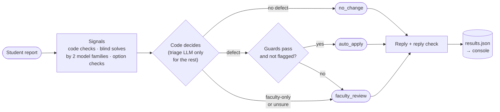

# Report → Fix: a triage engine and faculty console for student error reports

Students tap "Report error" on a JEE/NEET question and type whatever they like. This project decides, for
each report, whether the question is actually broken, proposes a surgical fix, and routes it:
- **auto_apply:** the evidence is strong enough to go live
- **faculty_review:** a teacher decides
- **no_change**

It also writes the student's reply. A faculty console shows the queue, the evidence and a before/after diff.

- **Live console:** https://acadza-assignment.vercel.app/
- **Video walkthrough:** https://drive.google.com/file/d/1i9Oj8G7K5UrUefLKH1x_6C5VfyFh3S7I/view?usp=sharing
- The original brief: [`docs/assignment-brief.md`](docs/assignment-brief.md). How it was built with AI:
  [`PROMPTS.md`](PROMPTS.md). Product thinking: [`PRODUCT.md`](PRODUCT.md).

## Results

**The 44 given reports (in-sample):**
- **44/44** verdict and verdict + repair, and 6/6 new keys, against the hand labels (run `20261111T063037Z`,
  `logs/runs/20261111T063037Z/eval.md`).
- Routes: 17 auto_apply, 11 faculty_review, 16 no_change. **0 wrong auto-applies.**
- One full run costs **$0.035** and takes 639 s, with 241,725 tokens in total.
- **Weak-model run** (gpt-oss-20b in place of gpt-oss-120b for solver 1 and the checks): **0 wrong
  auto-applies**. Verdicts were 43/44, and the one miss went to faculty (D-005).

**The held-out set** (32 reports, 10 new questions each with an injected defect, key kept outside the repo
until scored):
- **26/32** verdict + repair, **0 wrong auto-applies**.
- One policy failure, an injection report (H08) that auto-applied, is now fixed.

**Injection detection:**
- **9/20** on a fresh set before the fix (0/12 false alarms).
- **12/15** on an unseen set after one improvement round, with **2/10** false alarms. A false alarm only
  costs a faculty review.

Details: [`eval/heldout/README.md`](eval/heldout/README.md).

## How it works



1. **Signals.**
   - Code checks: parser, rule checks, claim sorter, injection detector and prompt guard.
   - Blind solves by two model families, which see only the question (no key, no comment).
   - Per-option and value checks, with a tie-breaker on the other family.
2. **Code decides** verdict, repair, route and confidence wherever the signals settle it (D-001, D-016). The
   triage LLM decides only the rest, and if it contradicts the signals the case goes to faculty.
3. **Guards:**
   - the edit touches only allowed fields, and its `find` occurs exactly once;
   - the risk-tiered auto bar (D-023);
   - two sources for content (D-020, D-021, D-024);
   - an injection flag blocks auto-apply (D-017, D-030, D-032).
4. **Reply:**
   - The reply LLM writes from facts given by code.
   - A check rejects a false action claim or any answer but the decision's, and falls back to a code-built
     reply.
   - A flagged report sent to faculty gets a fixed neutral reply that names no answer (D-031).

- Every LLM call is logged with its model, prompt version, tokens, latency and cache status
  (`logs/llm-calls.jsonl`). Every run writes a summary (`logs/run-summary.json`).
- Every tier runs on every report in shadow mode. In the final run, early exit would never have decided
  differently.

## Run it

Python 3.10+ (standard library only, plus pytest for tests). Put API keys in `.env` (see `.env.example`).

```powershell
python -m engine.run                         # all 44 reports -> results.json, logs/run-summary.json
python -m engine.run --offline               # replay from the LLM cache only (no network)
python -m engine.run --reports R001,R004     # a subset (results only under logs/runs/)
python -m engine.run --swap-model openai/gpt-oss-20b    # robustness run (logs/runs/ only)
python -m engine.run --questions eval/heldout/merged_questions.json `
    --reports-file eval/heldout/heldout_reports.json --out eval/heldout/results_heldout.json
python -m engine.bonus                       # question-level findings no report covered -> bonus_findings.json

python -m eval.evaluate_run                  # score the latest run against the hand labels
python -m eval.compare_runs logs/runs/<a> logs/runs/<b>
python -m eval.fresh_injection_check [OUT.csv [IN.csv]]   # injection detector alone on a comment set
python -m pytest tests
```

With `--out`, the root `results.json` and `logs/run-summary.json` are left alone.

Console (`console/`, Vite + React):

```powershell
cd console
npm install
npm run data      # optional: rebuild public/data.json from the engine outputs (data.json is committed)
npm run dev       # http://localhost:5173
npm run build     # static site in dist/
```

## How this scales

**Built:**
- **Cost grows with broken questions, not reports.** Duplicate reports on a question share its question-level
  calls (solves, extraction, audit, option checks) through a per-run memo, and LLM answers are cached by input
  hash.
- **Provider resilience:** a same-model fallback (Groq → OpenRouter after 60 s of rate limiting), and a hard
  per-run spend cap: a paid call whose worst-case cost would cross the cap is never sent (D-022).
- **Edits are surgical and checked:** `find` must occur exactly once, and only the repair's allowed fields
  may change. The console can undo an auto-applied edit.

**Designed, not built:**
- **Dedupe per question version:** key the cache and the case on (question id, content hash), so a fixed
  question gets a fresh look.
- **Instant acknowledgement plus an async queue:** the student gets a reply at once, and verification runs in
  the background in harm-first priority (the same ordering as the console, D-026).
- **Spike circuit-breaker:** when one question suddenly gets many reports, pause auto-apply on it and send it
  to faculty.
- **Offline corpus precompute:** run the code checks and blind solves over the whole corpus ahead of time,
  so most reports find their signals already computed.
- **Provider pools:** several providers per model family, with fallback and per-pool spend caps.
- **Versioned edits:** each edit hash-checked against the version it was made on, with undo, and re-grading
  of past attempts when a key changes.
- **Abuse controls:** per-student report rate limits and reporter reputation.
- **Console in production:** a backend with auth, case locking so two reviewers don't take the same case,
  and a server-side audit log.

```
 app ──report──► API ──ack──► student
                  │
                  ▼
            queue (harm-first) ──► workers: code checks · blind solves · checks · code decides
                  │                      │            ▲
                  │                      ▼            │ cache / precomputed signals
                  │              provider pools (fallback, spend caps)
                  ▼
     edit store (versioned, hash-checked, undo) ──► question service (+ re-grading)
                  │
                  ▼
     faculty console (backend: auth, case locks, server-side audit)
```

## Honest notes

- **44/44 is in-sample.** The prompts and rules were iterated on these 44 reports. The held-out set (26/32)
  is the better estimate.
- **Precomputed results.** The console makes no live AI calls; it reads `results.json` through
  `console/public/data.json` (D-006).
- **The audit log is in the browser** (localStorage), not on a server.
- **Free-tier and cheap models on purpose** (Groq gpt-oss-120b/20b, OpenRouter deepseek-v4-flash). Safety is
  meant to come from the harness, not the model (D-005).
- **Known misses, diagnosed but not fixed:**
  - P02: one wrong value check vetoes two agreeing solvers.
  - P08: a definite duplicate-option finding is dropped when the comment reads as an answer dispute.
  - Both went to a safe route; see `eval/heldout/README.md`.
- **Injection gaps that remain:** Devanagari text, personas without a role label, and authority phrasings
  outside the lists. They are listed in `eval/heldout/README.md`.

## Bonus findings

`bonus_findings.json` lists question-level issues that no report's outcome covers: **21 findings on 13
questions**.
- 8 come from code checks; 13 were added in manual review, each verified against the stored HTML (D-025).
- By type: spelling 8, notation 7, markup_leak 4, solution_fix 1, wrong_chapter 1.
- 1 could auto-apply under D-023. Each has evidence and, where possible, a guarded edit.
